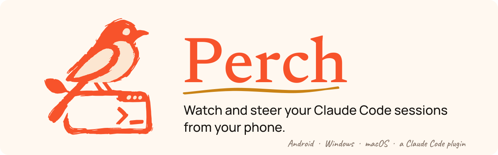
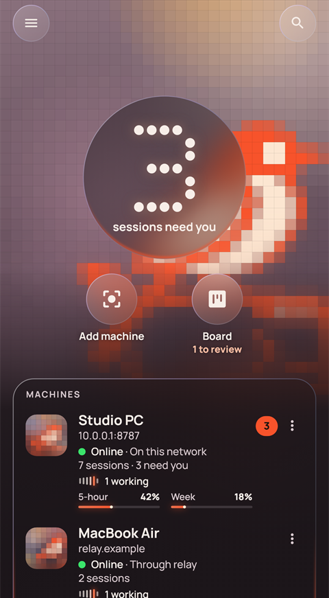
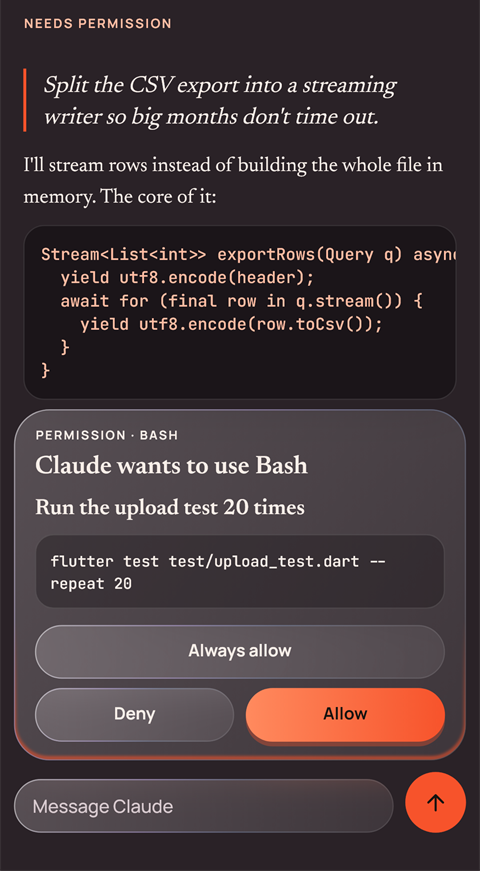
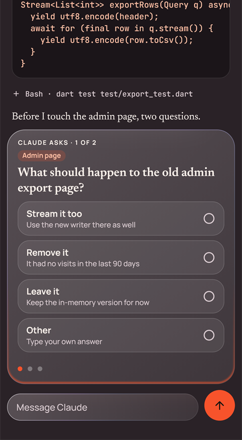
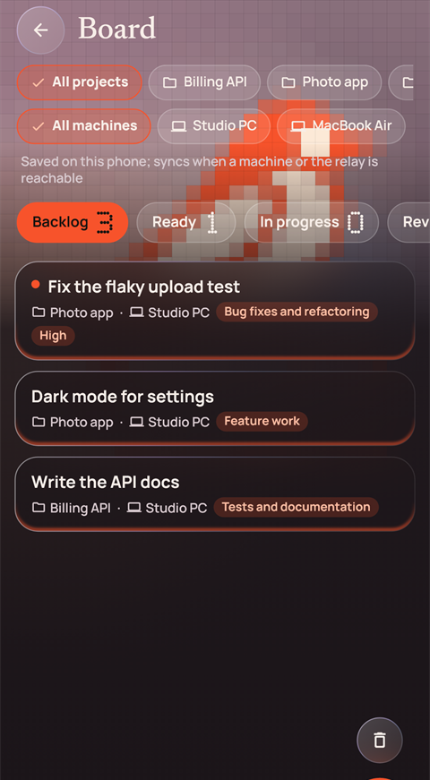
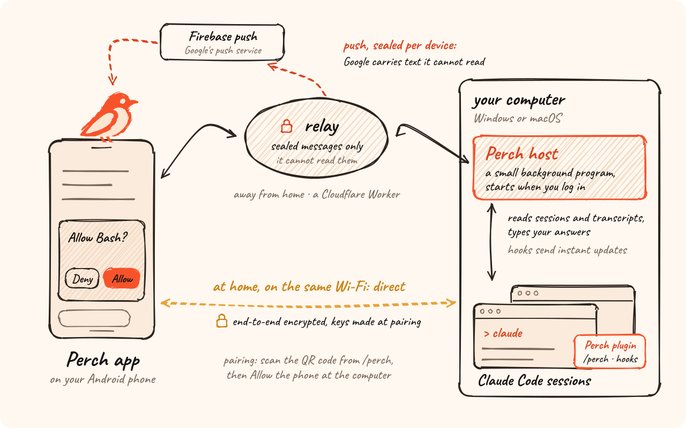
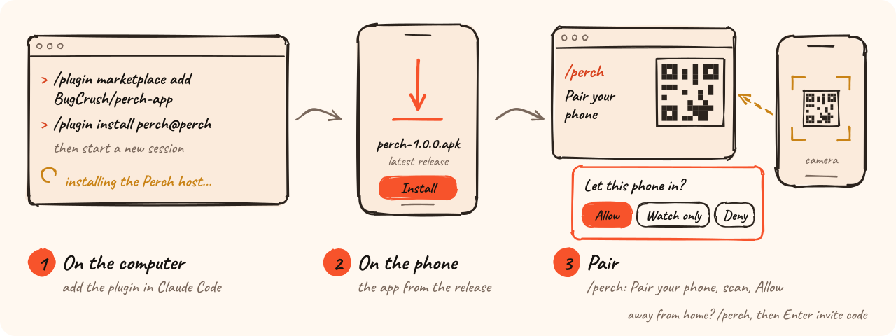
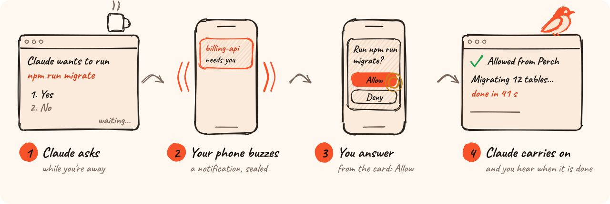
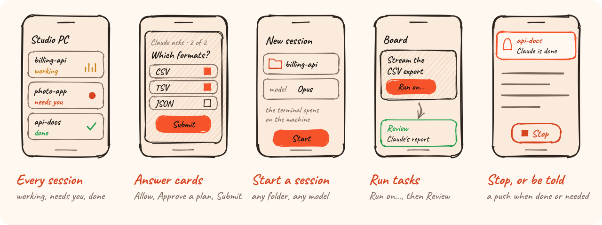

<a id="readme-top"></a>

<div align="center">

<picture>
  <source media="(prefers-color-scheme: dark)" srcset="assets/readme/banner-dark.svg">
  <source media="(prefers-color-scheme: light)" srcset="assets/readme/banner-light.svg">
  
</picture>

**Your Claude Code sessions, from your phone.**

[](https://github.com/BugCrush/perch-app/releases/latest)
[](LICENSE)


[Install](#install) · [How it works](#how-it-works) · [Features](#features) · [Privacy](#privacy-and-security) · [Report a bug](https://github.com/BugCrush/perch-app/issues)

<br>

<picture>
  <source media="(prefers-color-scheme: dark)" srcset="assets/readme/screen-home-dark.png">
  
</picture>
<picture>
  <source media="(prefers-color-scheme: dark)" srcset="assets/readme/screen-permission-dark.png">
  
</picture>
<picture>
  <source media="(prefers-color-scheme: dark)" srcset="assets/readme/screen-question-dark.png">
  
</picture>
<picture>
  <source media="(prefers-color-scheme: dark)" srcset="assets/readme/screen-board-dark.png">
  
</picture>

<sub>Screens with made-up demo data.</sub>

<br><br>

<picture>
  <source media="(prefers-color-scheme: dark)" srcset="https://raw.githubusercontent.com/BugCrush/perch-app/readme-assets/walker-dark.svg">
  <source media="(prefers-color-scheme: light)" srcset="https://raw.githubusercontent.com/BugCrush/perch-app/readme-assets/walker-light.svg">
  
</picture>

<sub>Perch's commits per day, redrawn on every push. The bird visits each day that saw work.</sub>

</div>

> **Beta.** Perch is being tested by a small group. Expect rough edges and tell us what breaks.

<details>
<summary><b>Contents</b></summary>

- [Why Perch](#why-perch)
- [Features](#features)
- [How it works](#how-it-works)
- [Install](#install)
- [Using Perch](#using-perch)
- [Updates](#updates)
- [Privacy and security](#privacy-and-security)
- [Troubleshooting](#troubleshooting)
- [FAQ](#faq)
- [Roadmap](#roadmap)
- [Build it yourself](#build-it-yourself)
- [Contributing](#contributing)
- [Licence](#licence)
- [Acknowledgments](#acknowledgments)

</details>

## Why Perch

Claude Code works for minutes at a time, then stops to ask something: may it run this command, does the plan look right, which of these options? If you have walked away, it waits.

Perch lets you watch and steer the Claude Code sessions running on your computers from an Android phone: see what every session is doing, answer Claude's questions and permission requests, send messages, start new sessions, and get a notification when Claude needs you or is done. It works with sessions you started in a terminal, not only ones Perch started.

## Features

- 🖥️ **Every session on every machine.** Live state (working, waiting for you, done), the conversation, **Stop**.
- 🃏 **Answer from anywhere.** Permission requests, plans and Claude's questions arrive as cards: **Allow**, **Deny**, **Approve**, or pick answers and **Submit**. Questions come as a deck: one page per question, then a summary with a single Submit.
- 🔔 **Notifications.** When a session needs an answer or finishes, and nothing while you are at the machine.
- ▶️ **Start sessions** in any folder, with the model you want; the terminal opens on the machine.
- 📋 **Task board.** Projects and tasks on your phone; run a task on a machine and get Claude's report back for review. `/perch` shows the same board inside Claude Code.
- 🔎 **Search** every conversation on every machine.
- ⏳ **Usage limits.** When your plan's limit hits, choose to continue when it resets, wait, or switch account.
- 🔒 **Private by design.** The phone and the machine talk end-to-end encrypted. The relay that connects them away from home only passes sealed messages it cannot read. A new phone must be allowed at the machine (Allow, Watch only, Deny), and the app can be locked with your fingerprint, face or PIN.
- ✍️ **Drafts** are kept per conversation until you send them.

## How it works

<picture>
  <source media="(prefers-color-scheme: dark)" srcset="assets/readme/how-it-works-dark.svg">
  
</picture>

- **The Perch app** (Flutter, Android 7.0 or newer) is what you hold.
- **The Perch host** is a small background program on each computer (Windows 10/11 x64 or macOS on Apple Silicon) that starts when you log in. It reads Claude Code's own session list and transcripts, types your answers into the terminals, and gets instant updates from Claude Code hooks.
- **The Perch plugin** for Claude Code ships those hooks and the `/perch` command, and installs and updates the host from this repository's Releases.
- **At home**, on the same Wi-Fi, the phone talks to the host directly. **Away from home** it goes through a relay, a Cloudflare Worker that only forwards sealed messages. Push notifications go host → relay → Firebase Cloud Messaging → phone, sealed for each device.

<p align="right"><a href="#readme-top">back to top ↑</a></p>

## Install

<picture>
  <source media="(prefers-color-scheme: dark)" srcset="assets/readme/install-dark.svg">
  
</picture>

**What you need:** Claude Code on the machine · **Windows 10 or 11 (x64)** or **macOS on Apple Silicon** · an **Android phone**, Android 7.0 or newer (no iPhone app yet). On the same Wi-Fi Perch works on its own; **away from home** it goes through a relay, which during the beta needs an **invite code**.

### 1. On each computer: the Claude Code plugin

In Claude Code, run:

```
/plugin marketplace add BugCrush/perch-app
/plugin install perch@perch
```

Then start a new Claude Code session. In the background the plugin downloads the Perch host for your system from this repository's Releases, checks its SHA-256 checksum, sets it to start when you log in, and starts it. It takes about a minute the first time and prints nothing; its log is `%APPDATA%\perch\setup.log` (Windows) or `~/.perch/setup.log` (Mac).

Turn on automatic updates once: `/plugin` → **Marketplaces** → **perch** → **Enable auto-update**.

<details>
<summary><b>On a Mac:</b> two permissions</summary>

Perch needs two permissions a plugin cannot give itself:

- **System Settings → Privacy & Security → Accessibility**: turn on **Terminal** (and **Warp** if you use it), so Perch can type your answers into terminal sessions.
- When macOS asks whether **"sh" may control "Terminal"**, choose **Allow** (that is how the host starts at login).

</details>

### 2. On your phone: the app

Download `perch-<version>.apk` from the [latest release](https://github.com/BugCrush/perch-app/releases/latest) on your phone and open it. Android asks you to allow installing apps from your browser once.

On Samsung phones: if notifications arrive late while the screen is off, set **Settings → Apps → Perch → Battery** to **Unrestricted**.

### 3. Pair them

1. In Claude Code on the computer, type `/perch` and choose **Pair your phone**. A QR code appears.
2. Scan it with your phone's camera: Perch opens and pairs. (Or in the app: **Add machine**, then scan.)
3. On the computer, Perch asks whether to let the phone in: choose **Allow** (or **Watch only** for a phone that may look but not act).

<details>
<summary><b>Away from home:</b> the invite code</summary>

If `/perch` says **"this relay needs an invite code"**, choose **Enter invite code**, type the code you were sent (`perch-xxxx-xxxx-xxxx`) and **Save**. On the same Wi-Fi everything works without it.

</details>

<p align="right"><a href="#readme-top">back to top ↑</a></p>

## Using Perch

<picture>
  <source media="(prefers-color-scheme: dark)" srcset="assets/readme/a-day-with-perch-dark.svg">
  
</picture>

<picture>
  <source media="(prefers-color-scheme: dark)" srcset="assets/readme/using-perch-dark.svg">
  
</picture>

- **Sessions** — open a machine to see its sessions. Tap one for its conversation; type to send it a message; **Stop** interrupts it.
- **Cards** — when Claude asks something, a card appears in the conversation (and as a notification). Questions come as a deck: one page per question, then your answers and **Submit**.
- **New session** — on a machine, **New session**, pick the folder and model; a terminal opens there.
- **Board** — projects and tasks. **Run on…** sends a task to a machine (a new session, or one that is idle); when Claude is done the task moves to **Review** with its report. In Claude Code, `/perch` lists the same board and can start a task in the current session.
- **Search** — every conversation on every machine.
- **Usage limit** — when the limit hits, the card offers **Continue when available**, **Wait** or **Switch account**.
- **Devices** — on the phone, the machine's menu lists the paired devices; remove one to lock it out.

## Updates

- **Computer**: with auto-update on, Claude Code updates the plugin, and the plugin moves the host to the new version when it is idle.
- **Phone**: the app says **Update available** when a newer release is out; tap **Download**.

## Privacy and security

- Messages between the phone and the machine are end-to-end encrypted with keys made at pairing; each phone has its own key.
- The relay (a Cloudflare Worker) only forwards sealed messages and stores short-lived counters and push tokens. Notifications are sealed too: Google's push service carries text it cannot read.
- A new phone must be allowed at the machine before it sees anything. Your Claude login and tokens stay on your machine.

<p align="right"><a href="#readme-top">back to top ↑</a></p>

## Troubleshooting

- **The phone does not find the machine**: run `/perch` on the computer; if it says the host is not running, start a new Claude Code session (the plugin starts it) and look at `setup.log`.
- **Works at home but not away**: the relay needs your invite code (`/perch`), or the shared daily allowance is used up (it resets at 00:00 UTC).
- **Answers are not typed into a terminal on a Mac**: check the Accessibility permission above.

Please report problems in [Issues](https://github.com/BugCrush/perch-app/issues).

## FAQ

<details>
<summary><b>Where do I get an invite code?</b></summary>

From the person who invited you to the beta. Each code is personal; please don't share it. This repository holds no codes.

</details>

<details>
<summary><b>Does Perch work without the relay?</b></summary>

Yes. On the same Wi-Fi the phone talks to your computer directly; the relay is only for reaching it away from home.

</details>

<details>
<summary><b>Can the relay read my code or my conversations?</b></summary>

No. Everything between the phone and the computer is end-to-end encrypted with keys made at pairing. The relay forwards sealed messages it cannot open, and notifications are sealed for each phone, so Google's push service cannot read them either.

</details>

## Roadmap

- [ ] iPhone app
- [ ] Google Play
- [ ] Perch's own domain
- [ ] A Linux build of the host (it runs on Linux from source today)

## Build it yourself

<details>
<summary>The source, the tests, your own relay</summary>

The source is all here: `packages/perch_host` (the host, Dart), `packages/perch_protocol` (the wire protocol), `apps/perch_app` (the app, Flutter), `relay/` (the Cloudflare Worker), and the plugin in `packages/perch_host/claude_plugin/perch`.

- Flutter 3.50 / Dart 3.14: run `flutter pub get` at the root, then `dart test` in `packages/*` and `flutter test` in `apps/perch_app`.
- Host: `dart run bin/perch_host.dart serve` in `packages/perch_host`.
- Your own relay: `npm ci` and `npx wrangler deploy` in `relay/` (a free Cloudflare account is enough), then `perch_host relay set <url>`. Push notifications need your own Firebase project (`google-services.json` for the app, the service-account key as the Worker secret `FCM_SERVICE_ACCOUNT`).
- The README's drawings: `npm ci` and `node build-art.mjs` in `tool/readme`; the commit walker is `tool/readme/walker.mjs` (plain Node).

</details>

## Contributing

Bug reports and ideas are welcome in [Issues](https://github.com/BugCrush/perch-app/issues). This repository is published from the project's working copy, so please open an issue before you send a pull request. Contributions are accepted under the same licence, the AGPL-3.0.

## Licence

Perch is free software under the [GNU Affero General Public License v3.0](LICENSE). If you run a modified Perch as a service for others, you must offer them its source.

## Acknowledgments

- [Flutter](https://flutter.dev) and Dart, for the app and the host.
- [Cloudflare Workers](https://workers.cloudflare.com), for the relay.
- [rough.js](https://roughjs.com) and [opentype.js](https://opentype.js.org), for the hand-drawn pictures in this README.
- The fonts, all under the SIL Open Font License: [Caveat](https://fonts.google.com/specimen/Caveat), [Newsreader](https://fonts.google.com/specimen/Newsreader), [Manrope](https://fonts.google.com/specimen/Manrope), [JetBrains Mono](https://www.jetbrains.com/lp/mono/).
- [shields.io](https://shields.io), for the badges.

<p align="right"><a href="#readme-top">back to top ↑</a></p>
